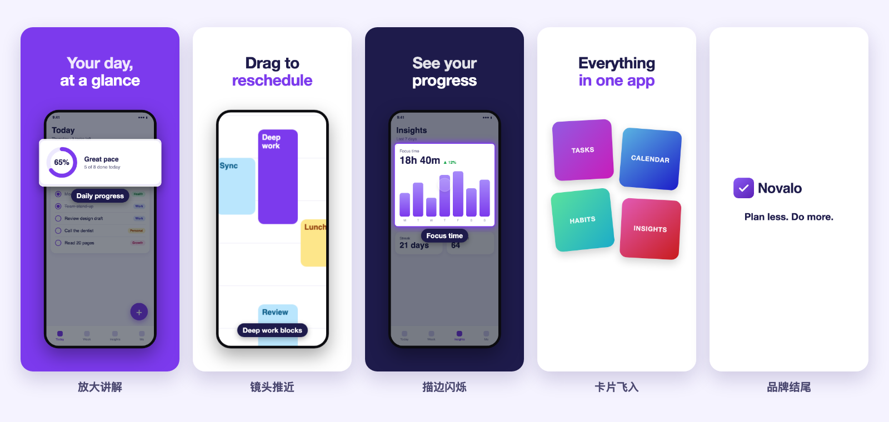
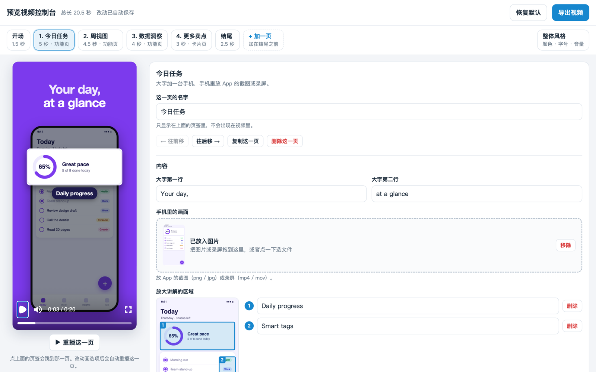

# App Preview Video · 应用商店预览视频

一个给 [Claude Code](https://claude.com/claude-code) 用的 skill：用代码做 App Store / Google Play 里的 **App 预览视频**，并附带一个**不用懂代码的中文网页控制台**。

> 对 Claude 说一句"帮我给某某 App 做一个应用商店的预览视频"，它会问你要素材、给你分镜表、搭好工程，然后把控制台交到你手里。之后改文案、换截图、选转场、调动效、导出 MP4，都在控制台里点一点就行。

<p align="center"></p>



<sub>示例里的 App「Novalo」是虚构的，截图也是画出来的，仅用于演示。</sub>

## 它能做什么

**视频**：竖屏 886×1920（6.9 英寸 iPhone）、30fps，结构是「开场图标 → 任意多个页面 → 品牌结尾」。

- **两种页面**：功能页（两行大字 + 手机里的 App 截图或录屏）、卡片页（两行大字 + 一组卖点卡片）。页面可以任意增删、改名、排序、复制。
- **讲解区域**：在截图上框出几块位置，视频里手指会点它，然后用「放大弹出 / 镜头推近 / 描边闪烁」三种方式之一讲解，并配一句说明。
- **转场**：上推、左推、右推、圆形扩散、三角推进、向下擦除、缩放、淡入、直接切换。
- **动效**：标题（弹出、上滑、淡入、打字、逐字弹出）、手机进场（升起、滑入、放大、倾斜转正）和进场后的动态（缓慢放大、漂浮、摆动）、卡片动画、开场和结尾的 Logo 动画、整体的弹跳感。
- **画面上的小动画**：先红后绿的两条提示（比如"No signal → Offline map"）；导航类截图里可以做「车不动、地图往车这边移动」的真实导航效果（可以标出不跟着动的卡片和按钮），也可以让车沿路线往前开。
- **首帧 → 尾帧**：手机画面播到一半切换成第二张截图（操作前 → 操作后），可选切换方式和切换前的手指点击。
- **录屏**：可以设从第几秒开始播、几倍速。
- **音效**：点击、弹出、转场、成功提示等 8 种，全部是用代码合成的原创音频，没有第三方素材。

**控制台**：本地运行的网页，左边实时预览视频，右边是当前页的设置。



- 截图和录屏直接拖进去；在截图上拖一个框就是一块讲解区域。
- 每个动效都是一排按钮，点一下会自动重播这一页看效果。
- 改动自动保存；顶部显示总时长，超出 App Store 的 15–30 秒范围会变红。
- 一键导出 MP4，放到桌面。

## 安装

需要 [Claude Code](https://claude.com/claude-code)。把仓库克隆到你的 skills 文件夹：

**Mac / Linux**

```bash
git clone https://github.com/DirectorKun/app-preview-video.git ~/.claude/skills/app-preview-video
```

**Windows（PowerShell）**

```powershell
git clone https://github.com/DirectorKun/app-preview-video.git "$env:USERPROFILE\.claude\skills\app-preview-video"
```

重新打开 Claude Code，skill 就会出现在可用列表里。

**需要的运行环境**：Node.js 22 以上、FFmpeg（导出视频用）。电脑上缺哪样，Claude 会先告诉你要下载什么、多大，征求你的同意后再下载：

- Node.js：从 nodejs.org 下载官方免安装版，校验官方公布的 SHA-256。
- FFmpeg：从 GitHub 上 [eugeneware/ffmpeg-static](https://github.com/eugeneware/ffmpeg-static/releases/tag/b6.1.1) 下载静态编译版（FFmpeg 6.0），校验 GitHub 公布的 SHA-256。

都放在你自己的用户文件夹里，只给这个 skill 用，不改动系统、不需要管理员密码。导出时会用电脑上已装的 Google Chrome 截图；没有 Chrome 的话，渲染器 HyperFrames 第一次导出时会自动下载一份浏览器（约 270MB）。

## 使用

在 Claude Code 里直接说，例如：

- "帮我给我们的记账 App 做一个 App Store 预览视频，官网是 …"
- "我想做一个像应用商店里那种广告动画，展示这三个功能"

Claude 会：

1. 问清楚 App、要展示的功能、素材和参考视频（有官网链接会自己去读）。
2. 给出分镜表：每页多长、手机里放什么、大字写什么、用什么转场。
3. 搭工程、填好内容、抽帧检查画面。
4. 打开控制台，告诉你怎么用。之后你可以自己调，也可以继续让 Claude 改。

素材还没到也没关系，可以先搭结构，功能页会显示占位。

## 仓库结构

```
SKILL.md                 给 Claude 看的说明：流程、注意事项、常见问题
references/settings.md   每个设置项的含义
scripts/                 新建工程的脚本（Mac/Linux 用 .sh，Windows 用 .ps1）
assets/template/         工程模板
  src/AppPreview.tsx       视频本身（React）
  src/engine.tsx           自己写的小动画引擎：帧号、插值、弹簧、时间段、录屏、音效
  src/settings.json        所有可调内容，控制台读写的就是它
  control/                 控制台（Vite + React），player.tsx 是预览播放器
  render/                  导出：打包成合成页，交给 HyperFrames 逐帧渲染、FFmpeg 编码
  public/sfx/              合成音效；tools/make_sfx.py 可以重新生成
docs/                    README 里的图片
```

## 需要知道的事

- **不依赖 Remotion。** 早期版本用 Remotion 做视频引擎，它对 3 人以上的营利公司要求购买许可。现在动画由仓库里自己写的 `src/engine.tsx` 驱动，导出用 HeyGen 开源的 [HyperFrames](https://github.com/heygen-com/hyperframes)（Apache-2.0），公司商用不需要额外许可。HyperFrames 的使用统计在导出脚本里默认关闭。
- **用真实界面。** 苹果要求预览视频以 App 内的真实画面为主。控制台里的动效是包装，手机里应该放真实的截图或录屏。
- **Windows 还没实测。** 安装脚本和启动器按 Windows 的规则写好了，但目前只在 macOS 上完整测试过。遇到问题欢迎提 issue。
- **其他商店和机型。** 模板是 6.9 英寸 iPhone 的尺寸。其他机型或 Google Play 的规格不同，提交前请对照官方要求。

## 许可证

本仓库的代码、文档和合成音效以 [Apache License 2.0](LICENSE) 发布。依赖的第三方库（包括 HyperFrames、FFmpeg）遵循各自的许可证。
